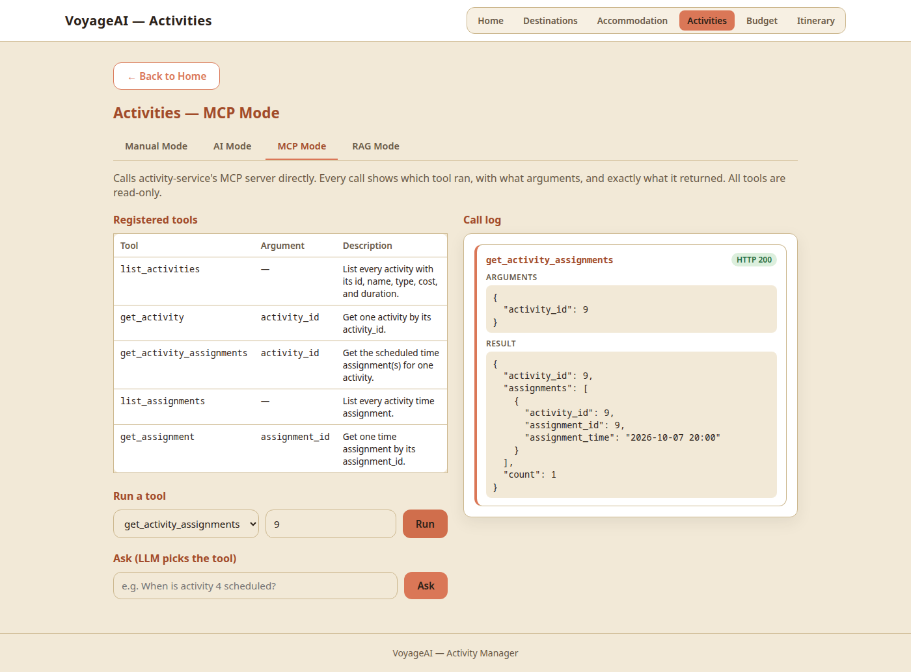
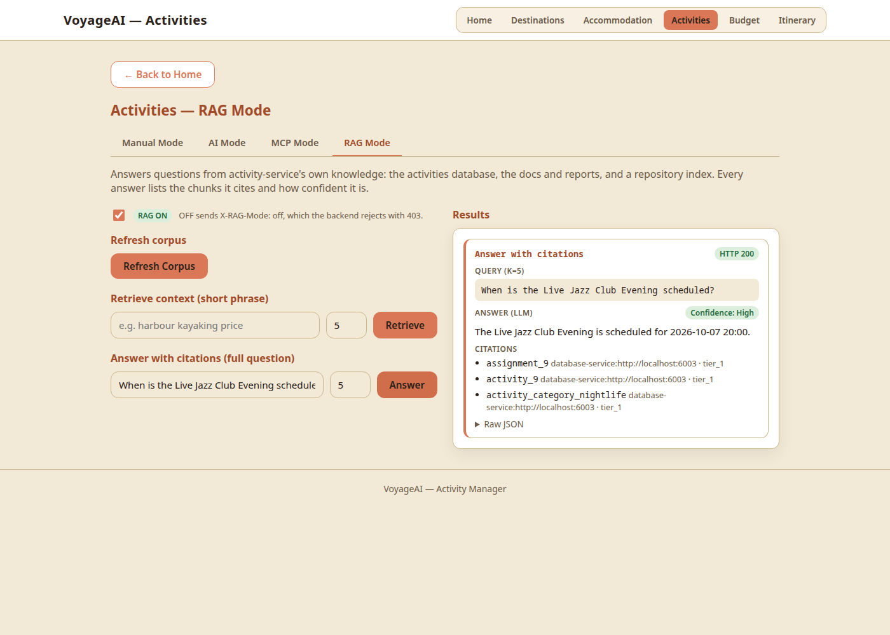
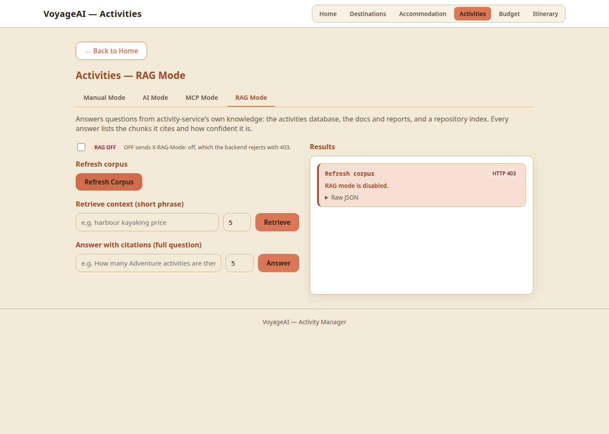

# Local MCP and RAG Integration Validation — activity-service

This report covers Release 1's "Local MCP and RAG Integration Validation" for the Activities feature. The outputs below are actual, captured on 2026-09-27 (AEST) on localhost.

| Criterion | Evidence | Result |
|---|---|---|
| MCP interaction through the **frontend UI**, returning a valid tool result | Real Chrome clicks on the MCP Mode tab → `get_activity_assignments(9)` returns activity 9's assignment ([screenshot](screenshots/mcp-mode-tool-call.png)) | ✅ |
| MCP interaction through the **backend/API**, returning a valid tool result | `POST /api/activity/mcp/activity` → `get_activity` returns activity 1 | ✅ |
| RAG interaction through the **frontend UI**: grounded answer, source citations, confidence category | Real Chrome clicks on the RAG Mode tab → correct time, 3 tier_1 citations, "Confidence: High" ([screenshot](screenshots/rag-mode-answer.png)) | ✅ |
| RAG interaction through the **backend/API**: grounded answer, source citations, confidence category | `POST /api/activity/rag/answer` → the same grounded answer, citations and `confidence_category: High` | ✅ |
| Shared agentic loop run in **MCP** mode, output captured | Option 1 (shared MCP server) and option 4 (Activity MCP) | ✅ |
| Shared agentic loop run in **RAG** mode, output captured | Option 2 (shared RAG server) and option 3 (Activity RAG) | ✅ |

## Setup

```bash
# from the repo root: containers (the root stack's volumes hold the seeded data)
docker network inspect microservices-net >/dev/null 2>&1 || docker network create microservices-net
docker compose up -d activity-database activity-backend activity-frontend
docker compose up -d budget-database accommodation-database   # data for the shared MCP mode (option 1)

# on the host (not containerised), each in its own terminal
cd activity-service/mcp-server && python mcp_http_server.py      # :7003
cd activity-service/rag-server && python rag_http_server.py      # :6013 (needs `ollama pull nomic-embed-text`)
```

**Running services:**

| Service | Port | Where |
|---|---|---|
| activity frontend | **3003** (root stack) | container |
| activity backend | 5003 | container |
| activity database-service | 6003 | container |
| accommodation database | 6002 | container |
| budget database | 6004 | container |
| activity MCP HTTP server | 7003 | host |
| activity RAG HTTP server | 6013 | host |
| Ollama (`qwen2.5:0.5b`, `llama3.1:8b`, `nomic-embed-text`) | 11434 | host |

```
$ curl -s localhost:7003/health
{"status": "ok", "service": "activity-mcp-server", "tools": ["list_activities", "get_activity", "get_activity_assignments", "list_assignments", "get_assignment"]}
$ curl -s localhost:6013/health
{"status": "ok", "service": "activity-rag-server", "tools": ["refresh", "retrieve", "answer"], "embedding_mode": "ollama", "model": "qwen2.5:0.5b"}
```

## 1. MCP: frontend UI

The page was driven in real Chrome (headless) by `tests/ui_demo.py`:

1. open http://localhost:3003/mcp-mode;
2. select `get_activity_assignments` and type `9`;
3. click **Run**.

The request path is browser → frontend :3003 → backend :5003 → MCP HTTP server :7003 → database-service :6003.



The card text, as read from the page:

```
get_activity_assignments                                  HTTP 200
ARGUMENTS  {"activity_id": 9}
RESULT     {"activity_id": 9, "assignments": [{"activity_id": 9, "assignment_id": 9,
            "assignment_time": "2026-10-07 20:00"}], "count": 1}
```

## 2. MCP: backend/API

```
$ curl -s -X POST localhost:5003/api/activity/mcp/activity -H "Content-Type: application/json" -d '{"activity_id": 1}'
{
  "arguments": {"activity_id": 1},
  "result": {"activity": {"activity_cost": 45.0, "activity_id": 1, "activity_name": "Harbour Kayaking Tour",
                          "activity_type": "Adventure", "duration": "2 hours"}},
  "status": "success",
  "tool": "get_activity"
}
HTTP 200
```

## 3. RAG: frontend UI

The page was driven in real Chrome:

1. open http://localhost:3003/rag-mode, with **RAG ON**;
2. type "When is the Live Jazz Club Evening scheduled?" into **Answer with citations**;
3. click **Answer**.

The request path is browser → frontend :3003 → backend :5003 → RAG HTTP server :6013 (ChromaDB + Ollama).



```
Answer with citations                                     HTTP 200
QUERY (K=5)  When is the Live Jazz Club Evening scheduled?
ANSWER (LLM)                                              Confidence: High
The Live Jazz Club Evening is scheduled for 2026-10-07 20:00.
CITATIONS
  assignment_9                 database-service:http://localhost:6003 · tier_1
  activity_9                   database-service:http://localhost:6003 · tier_1
  activity_category_nightlife  database-service:http://localhost:6003 · tier_1
```

**Grounded:** `2026-10-07 20:00` is exactly the `assignment_time` of `assignment_9`, the first citation. It is also the value MCP returned in section 1.

**The OFF toggle, in the same browser session:** the script unchecked RAG, reloaded the page (it stayed **OFF**, so the setting persists) and clicked Refresh Corpus. The backend rejected it:

```
Refresh corpus                                            HTTP 403
RAG mode is disabled.
```



## 4. RAG: backend/API

```
$ curl -s -X POST localhost:5003/api/activity/rag/answer -H "Content-Type: application/json" \
       -d '{"query": "When is the Live Jazz Club Evening scheduled?"}'
{
  "answer": "The Live Jazz Club Evening is scheduled for 2026-10-07 20:00.",
  "answer_source": "llm",
  "citations": [
    {"authority_tier": "tier_1", "chunk_id": "assignment_9", "source_id": "database-service:http://localhost:6003"},
    {"authority_tier": "tier_1", "chunk_id": "activity_9", "source_id": "database-service:http://localhost:6003"},
    {"authority_tier": "tier_1", "chunk_id": "activity_category_nightlife", "source_id": "database-service:http://localhost:6003"}
  ],
  "confidence_category": "High",
  "model": "qwen2.5:0.5b",
  "retrieval_summary": {"embedding_mode": "ollama", "k": 5, "retrieval_mode": "vector", "retrieved_count": 5, "top_chunk": "assignment_9"},
  "status": "success"
}
HTTP 200
```

## 5. Shared agentic loop: MCP and RAG modes

```bash
printf '1\n2\n3\n4\n0\n' | AGENTIC_IMPLEMENTATION_MODEL=qwen2.5:0.5b AGENTIC_REVIEW_MODEL=llama3.1:8b \
  python ai-services/agentic_loop/app_main.py
```

**Menu:**

- 1: MCP (shared server)
- 2: RAG (shared server)
- 3: Activity RAG
- 4: Activity MCP

The implementation model is qwen2.5:0.5b and the review model is llama3.1:8b. The output is verbatim, with the `[stage]` trace lines trimmed.

### Option 1: MCP (shared `ai-services/mcp-server`)

This run had the budget (:6004) and accommodation (:6002) databases up. Checked directly, `list_expenses()` returned 12 expenses and `get_accommodation_by_destination("Tokyo")` returned 1 record.

```
OBSERVE: MCP evidence: ai-services/mcp-server/ contains tools.py, server.py, and mcp_http_server.py; 4 tools defined
(list_expenses, get_accommodation_by_destination, project_files, ci_report); all 4 tools executed without raising;
mcp prompts exist.
IMPLEMENTATION: Assessment: The 4 MCP tools are correctly implemented, using only the observed evidence.
REVIEW: Strengths: 4 tools correctly implemented, executed without errors, and mcp prompts exist.
Risks: None identified.
Recommendations: None.
```

### Option 4: Activity MCP (`activity-service/mcp-server`)

```
OBSERVE: Activity MCP evidence: activity-service/mcp-server/ has tools.py, server.py (FastMCP stdio), mcp_http_server.py
and mcp-config.json; server.py registers exactly ['list_activities', 'get_activity', 'get_activity_assignments',
'list_assignments', 'get_assignment']; no write tools. All 5 tools executed against the live database without errors:
list_activities count=10, list_assignments count=10, get_activity -> {"activity_cost": 45.0, "activity_id": 1,
"activity_name": "Harbour Kayaking Tour", "activity_type": "Adventure", "duration": "2 hours"},
get_activity_assignments count=1, get_assignment -> {"activity_id": 1, "assignment_id": 1,
"assignment_time": "2026-10-02 09:00"}. MCP HTTP server (:7003) healthy with tools ['list_activities', 'get_activity',
'get_activity_assignments', 'list_assignments', 'get_assignment'].
IMPLEMENTATION: All 5 tools executed correctly, no write tools registered.
REVIEW: Verdict: CORRECT
Checks:
1. Tool set: PASS (all 5 read-only tools present)
2. Success: PASS (all tools return real data in documented shape)
3. Not found / empty: UNVERIFIED (no evidence of missing id or empty table)
4. Invalid input: UNVERIFIED (no evidence of non-integer, zero, or negative id rejection)
5. Failure: UNVERIFIED (no evidence of database or MCP server down)
6. Gating: UNVERIFIED (no evidence of MCP_ENABLED=false or X-MCP-Mode: off)
7. /ask: UNVERIFIED (no evidence of unparseable model output or unknown tool)
8. Transparency: UNVERIFIED (no evidence of MCP tab showing tool, arguments, status, and result)
Risks: None identified from the provided evidence.
Recommendation: Test the integration with invalid input, missing id, and empty table scenarios to verify checks 3-5.
```

Checks 3–7 are UNVERIFIED only because the loop's evidence covers the happy path. They are covered by the 72 tests in `tests/test_mcp_tools.py`, and gating (check 6) is also shown live in `run-report.md`. Check 8 (transparency) is shown by the screenshot in section 1.

### Option 2: RAG (shared `ai-services/rag-server`)

```
OBSERVE: RAG evidence: ai-services/rag-server/ contains rag_pipeline.py, rag_server.py, and rag_http_server.py;
3 tools defined (refresh_corpus, retrieve_context, answer_question); confidence_category present=True;
insufficient-context handling present=True.
IMPLEMENTATION: All RAG tools are defined and callable, answer_question returns citations and a confidence category,
and insufficient-context handling is present.
REVIEW: Risk: Insufficient evidence on corpus design, chunking, and vector store usage.
Correction: Review rag_pipeline.py for corpus design and chunking implementation.
Retest: Verify vector store usage in rag_server.py and rag_http_server.py.
```

### Option 3: Activity RAG (`activity-service/rag-server`)

```
OBSERVE: Activity RAG evidence: activity-service/rag-server/ has rag_pipeline.py, rag_server.py (FastMCP stdio),
rag_http_server.py and rag_eval.py; 3 tools defined. refresh_corpus -> chunk_count=111,
tiers={'tier_1': 28, 'tier_2': 82, 'tier_3': 1}, embedding_mode=ollama, vector_store=ready.
retrieve_context('total number of activities', k=5) -> retrieval_mode=vector, 5 results, top=activity_count
(tier_1, distance=0.143). answer_question('What does the Harbour Kayaking Tour cost?') -> status=success,
answer_source=llm, answer='The Harbour Kayaking Tour costs 45.00.', citations=['activity_1', 'activity_6',
'assignment_1', 'activity_category_adventure', 'activity_2'], confidence=High. Latest eval: mean P@5=0.24, mean R@5=0.70.
IMPLEMENTATION: The activity-service/rag-server/ rag_pipeline.py has the following RAG pipeline: refresh_corpus,
retrieve_context, answer_question. Latest eval: mean P@5=0.24, mean R@5=0.70.
REVIEW: Risk: Low P@5 (0.24) indicates potential issues with retrieval quality.
Correction: Review chunk count (111) and tier distribution to ensure sufficient relevant chunks.
Retest: Evaluate retrieval mode (vector) and distance metric (0.143) for accuracy.
```

## Notes

- **Options 1 and 2 validate the shared `ai-services/` servers; options 3 and 4 validate this feature's own RAG and MCP servers.** Option 4 was added so the Activities feature is validated by the loop in both modes, not only through the shared servers.
- **Option 1's collector only checks that no tool raised**, which is why its review found "no risks".
  - `ci_report("budget-service")` returned a structured error (budget-service has no CI `report.json`). That gap belongs to budget-service's evidence, not the MCP server.
  - Option 4's collector fails OBSERVE if any activity tool returns `{"error": ...}`.
- **Option 2's collector only checks that files and strings exist**, so its review rightly asks for more evidence. Option 3's collector executes the tools and reads the evaluation metrics.
- **Re-running the UI evidence:** `python tests/ui_demo.py docs/reports/screenshots` from `activity-service/`. It needs `pip install playwright` and uses the system Chrome.
