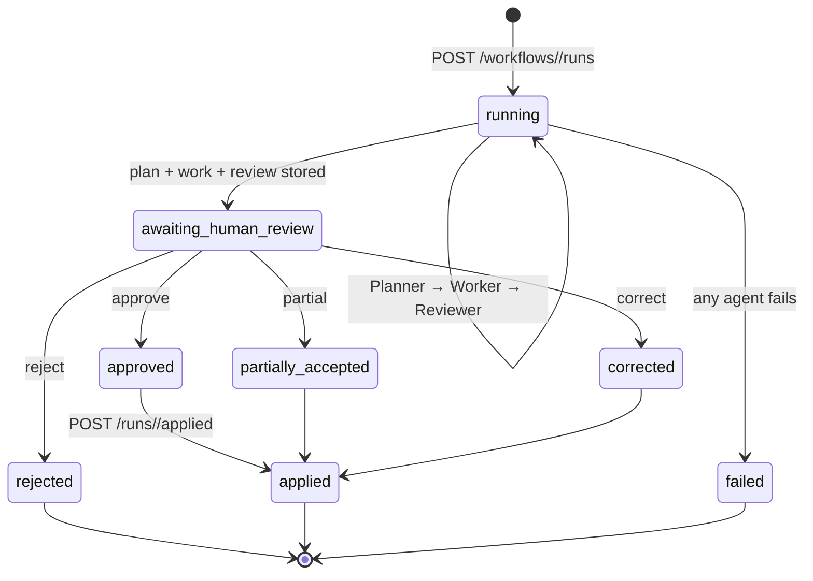

# Shared Multi-Agent Server

One shared, **non-containerised** server that runs every feature's
**Planner → Worker → Reviewer → Human Review** workflow. It sits next to the
shared MCP server (7001) and RAG server (7002). It is not in `docker-compose.yml`.

| | |
|---|---|
| Port | **7004** (`MULTI_AGENT_PORT`). Not 7003, which Activity's retired server used. |
| From the host | `http://localhost:7004` |
| From a feature container | `http://host.docker.internal:7004` (`MULTI_AGENT_SERVICE_URL`) |
| State | `runs.db` (SQLite) and `logs/audit.jsonl` (append-only). Both are gitignored, and runs survive a restart. |

## Start

```bash
cd ai-services
python -m venv .venv && source .venv/bin/activate      # Windows: .venv\Scripts\activate
pip install -r multi-agent-server/requirements.txt

cd multi-agent-server && python server.py              # :7004
python cli.py health                                   # in another terminal
```

`./up-all.sh` starts it in the background together with MCP and RAG. `./down-all.sh` stops all three.

For useful output you need Ollama on `:11434` with `qwen2.5:7b`, the MCP server on 7001, and the
feature database containers. Without them the server still runs: Planner and Reviewer fall back to
the workflow's deterministic output, and tool calls return `{"error": ...}`.

| Env var | Default |
|---|---|
| `MULTI_AGENT_PORT` | `7004` |
| `OLLAMA_BASE_URL` / `OLLAMA_MODEL` / `OLLAMA_TIMEOUT_SECONDS` | `http://localhost:11434` / `qwen2.5:7b` / `60` |
| `MCP_SERVICE_URL` | `http://localhost:7001/mcp` (the legacy `POST /<tool>` shim on the same host is the fallback) |
| `RAG_SERVICE_URL` | `http://localhost:7002` |
| `MULTI_AGENT_DB_PATH` / `MULTI_AGENT_AUDIT_LOG` | `./runs.db` / `./logs/audit.jsonl` |

## Run lifecycle



- **One human decision per run.** A second `/review` returns **409**.
- `/applied` can be called **once** and only after approve, partial or correct. A rejected run returns **409**.
- **Planner/Reviewer:** the LLM must return strict JSON, which is validated. If it is invalid the agent
  **retries once**, then uses the workflow's `fallback_plan` / `fallback_review`. The run still succeeds,
  and its history shows `source: "fallback"`.
- **Worker:** the Worker runs inside the generic agent wrapper, so it is timed and logged like the other
  agents. If it raises, or returns the wrong shape, the run moves to **failed**.
- A run that was in progress when the server stopped is marked `failed` at the next start.

## Workflow plugin contract

```python
# ai-services/multi-agent-server/workflows/<name>.py
from core.workflow import Workflow, RunContext

class MyWorkflow(Workflow):
    name = "my_workflow"                  # unique, snake_case, prefixed by feature e.g. budget_*
    description = "..."
    allowed_tools = ["list_expenses"]     # MCP tools this workflow may call (read-only unless justified)
    uses_rag = True

    def validate_input(self, payload: dict) -> dict: ...        # raise ValueError -> HTTP 400
    def planner_prompt(self, payload: dict) -> str: ...         # Planner LLM prompt; must return JSON plan
    def fallback_plan(self, payload: dict) -> dict: ...         # deterministic plan if LLM fails
    def work(self, payload: dict, plan: dict, ctx: RunContext) -> dict: ...
        # Worker: ctx.mcp(tool, args), ctx.rag(query), ctx.llm(prompt) -> must return
        # {"items":[{"id":..., ...}], "summary":..., "evidence":[...]}; arithmetic in Python
    def reviewer_prompt(self, payload: dict, plan: dict, work: dict) -> str: ...
    def fallback_review(self, payload: dict, plan: dict, work: dict) -> dict: ...
        # review JSON: {"risk":"low|medium|high","findings":[...],"recommendations":[...]}
```

The module must also export it, as either the class or an instance:

```python
WORKFLOW = MyWorkflow
```

### Details the contract relies on

| Item | Behaviour |
|---|---|
| `name` | Must match `^[a-z][a-z0-9]*(_[a-z0-9]+)+$` and be unique. A module that breaks the contract is skipped and listed under `workflow_errors` on `/health`. It never stops the server. |
| `ctx.mcp(tool, args)` | Returns the tool result, or `{"error": ...}` when the tool or transport fails. A tool **not in `allowed_tools`** raises `ToolNotAllowedError` before any network call. The refusal is logged to history and audit, and the run fails unless you catch the error. |
| `ctx.rag(query, k=5, endpoint="retrieve"\|"answer", **scope)` | Returns the RAG server's JSON body, for example with `scope="itinerary", trip_reference=...`. Needs `uses_rag = True`, otherwise it raises `ToolNotAllowedError`. |
| `ctx.llm(prompt, system=None, json_mode=True)` | Returns a parsed `dict` (or text), or `None` if Ollama failed. Every call is recorded in `tools_called`. |
| `items[].id` | Required and unique. The human reviewer approves, rejects and edits by these ids, compared as strings. |
| Optional `validate_plan(self, plan, payload)` | The default checks that the plan is a non-empty object and that every `steps[].tool` is in `allowed_tools`. Override it to tighten the check. Raise `ValueError`, which triggers a retry and then the fallback. |
| Optional `validate_review(self, review)` | The default checks `risk` ∈ low/medium/high and that `findings` and `recommendations` are lists. |

Totals, sums and dates are computed **in Python inside `work()`**, never by the LLM.

## How to add your feature's workflow (5 steps)

1. **Copy the example.** Copy `workflows/example_readonly.py` to `workflows/<feature>_<what>.py`, for example
   `budget_overspend_check.py`. Set `name` to the same `<feature>_<what>`.
2. **Declare what it may touch.** List only the MCP tools you need in `allowed_tools`; prefer read-only
   tools (see `../mcp-server/tool-contracts.md`). Set `uses_rag`. If your tool doesn't exist yet,
   add it to the MCP server first.
3. **Write the six methods.** Validate input (`ValueError` → 400). Write a planner prompt that returns
   JSON, plus a deterministic `fallback_plan`. Write `work()` using `ctx.*` that returns `items` with
   ids. Write a reviewer prompt plus a `fallback_review`.
4. **Test it without Ollama.** Copy `tests/test_lifecycle.py::test_full_lifecycle` for your workflow
   (fixtures fake Ollama/MCP/RAG), then try it live:
   `python cli.py run <name> --input '{...}'` → `python cli.py review <run_id> --decision partial --approve 1`.
5. **Wire your backend.** Your backend calls `POST /workflows/<name>/runs`, shows `plan`/`work`/`review`
   in the UI, sends the human decision to `POST /runs/<id>/review`, writes the returned
   `approved_items` to **your own** database, then calls `POST /runs/<id>/applied` with the created ids.
   Guard it with `MULTI_AGENT_ENABLED` (false in the cloud) and open the PR.

The server **never writes to a feature database**. Only the owning backend applies approved items.

## HTTP API

Full request and response shapes are in [tool-contracts.md](tool-contracts.md). Every response uses the envelope
`{"status": "success", "result": ...}` / `{"status": "error", "error": ...}`.

| Method | Path | Success | Errors |
|---|---|---|---|
| GET | `/health` | 200 | |
| GET | `/workflows` | 200 | |
| POST | `/workflows/<name>/runs` | **201** | 400 invalid input, 404 unknown workflow, 500 run failed |
| GET | `/runs?workflow=&limit=` | 200 | 400 bad limit |
| GET | `/runs/<id>` | 200 | 404 |
| GET | `/runs/<id>/history` | 200 | 404 |
| POST | `/runs/<id>/review` | 200 | 400, 404, **409** already decided |
| POST | `/runs/<id>/applied` | 200 | 400, 404, **409** rejected / not reviewed / already applied |

## Terminal

```bash
python cli.py workflows
python cli.py run example_readonly --input '{"tools": ["list_destinations"]}'
python cli.py show <run_id>
python cli.py history <run_id>
python cli.py review <run_id> --decision partial --approve 1,2 --reject 3 --edit '3:{"x":1}' --note "..."
python cli.py applied <run_id> --created 10,11 --target budget-db
python cli.py runs --workflow example_readonly
```

Add `--json` before the command for raw output. Set the URL with `--url` or `MULTI_AGENT_SERVICE_URL`.

## Audit log

Each line of `logs/audit.jsonl` holds:
`ts, run_id, workflow, step, agent, input_summary, output, tools_called, duration_ms, model, error`.
LLM steps also record `source` (`llm`/`fallback`) and `attempts`. Steps are `plan`, `work`, `review`,
`tool_refused`, `human_review` and `applied`. The Release 2 agentic-loop `multi-agent-review` mode reads this file.

## Tests

```bash
pip install -r requirements-dev.txt
python -m pytest            # Ollama, MCP and RAG are faked; no services needed
```
