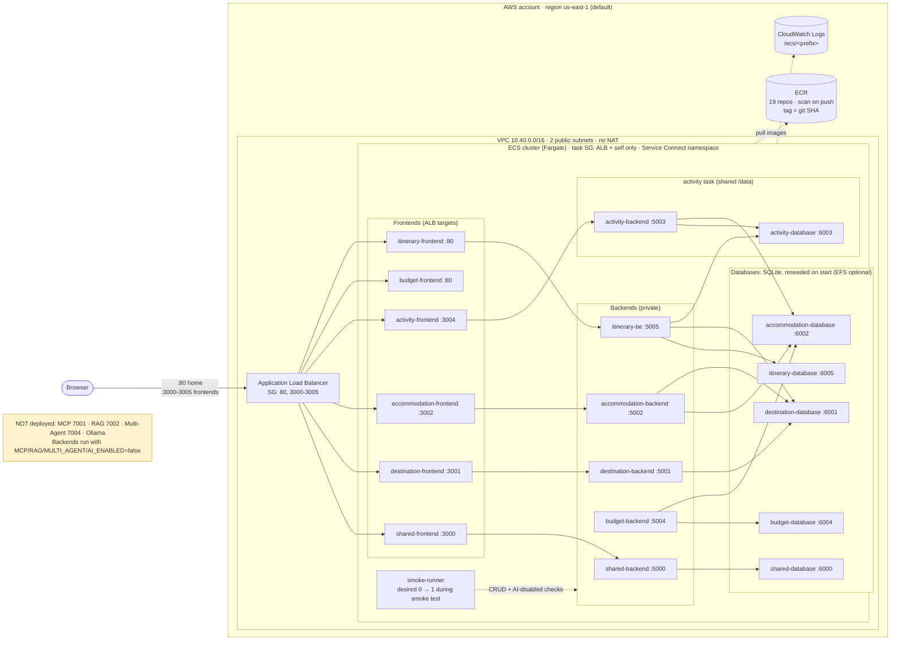
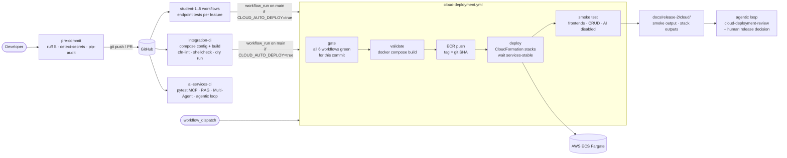

# VoyageAI cloud architecture (Release 2)

## AWS reference architecture

- **One ALB with port listeners** mirrors the local ports. Frontends serve at `/`, so path routing would
  break them. Port 80 also serves the home page, because some networks block 3001–3005.
- **Service Connect** gives every server its docker-compose `hostname:port`, so no env var or student
  code changes are needed. Backends and databases are reachable only inside the task security group.
- **Public subnets without a NAT gateway** keep cost down. Tasks get public IPs only to pull images
  from ECR, and the security group admits traffic from the ALB and from other tasks only.
- **SQLite is ephemeral.** Each database reseeds on start. Optional EFS (`ENABLE_EFS=true`) persists it.
- **No AI in the cloud.** The four AI flags are `false` on every backend, and AI hosts resolve to
  `ai-disabled.invalid`.

## DevOps flow

| Stage | Where | Evidence |
|---|---|---|
| Pre-commit security scans | developer machine (`pre-commit install`) | `docs/release-2/<who>/pre-commit-*.txt` |
| Feature endpoint tests | `student-1..5.yml` | JUnit artifacts per workflow |
| Integration build | `integration-ci.yml` | run log |
| Deploy gate | `cloud-deployment.yml` → `gate` | `gate-table` artifact + job summary |
| Deploy + smoke | `cloud-deployment.yml` | `deployment-outputs` and `smoke-test-output` artifacts |
| Release review | `app_main.py --mode cloud-deployment-review` | `docs/release-2/agentic-loop/cloud-deployment-review-*.md` |
