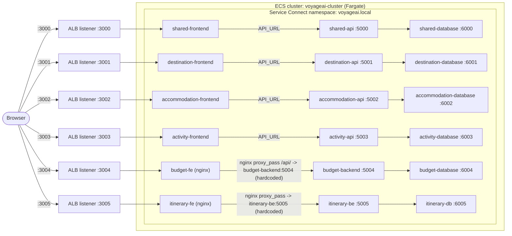
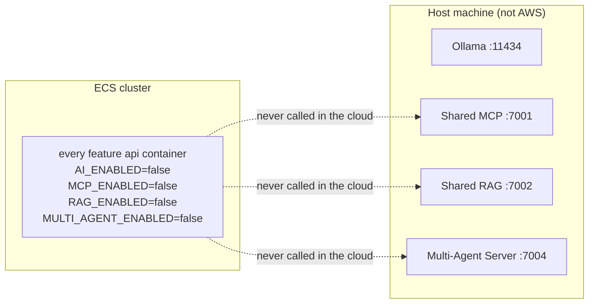

# VoyageAI cloud architecture (whole stack), Release 2

Extends the ECR → ECS Fargate → ALB shape already documented for Budget alone in
[`docs/release-2/student-4/architecture.md`](../student-4/architecture.md) to all six service groups:
`shared`, `student-1` (Destination), `accommodation-service`, `activity-service`, `budget-service`,
`itinerary-service`. The canonical per-container parameters (ports, Dockerfile paths, Service Connect
names, env vars) live in [`scripts/deploy/aws/services.yml`](../../../scripts/deploy/aws/services.yml) —
this document explains the shape; that file is what the setup guide and the agentic loop's
`cloud-deployment-review` mode actually read.

Nothing described here is deployed yet — see
[`aws-setup-guide.md`](aws-setup-guide.md) for the steps to actually stand it up.

## 1. One ALB, six frontends, one cluster

- The ALB is the **only** public ingress. Every other arrow is internal cluster traffic over
  Service Connect DNS (`<name>.voyageai.local`), same as how each service already reaches sibling
  services today via Docker Compose network aliases.
- Database tiers are never attached to a target group — matching the existing rule that only the
  database tier opens its SQLite file, and nothing outside the cluster should reach it directly.
- `budget-fe` and `itinerary-fe` are nginx reverse proxies with the backend hostname **hardcoded** in
  their `nginx.conf` (`budget-backend:5004`, `itinerary-be:5005`). Their Service Connect discovery
  names in `services.yml` must match those exact strings, or the proxy breaks — every other
  service resolves its backend through an env var (`API_URL` / `DATABASE_SERVICE_URL`), so those
  discovery names are free to pick as long as the env var matches.

## 2. Cross-feature calls stay the same shape

`accommodation-api` calls `destination-api`, `activity-api` calls `accommodation-api`, `itinerary-be`
calls both `destination-api` and `activity-api` — exactly the `*_SERVICE_URL` env vars each already
uses locally, just pointed at Service Connect DNS names instead of Docker Compose network aliases.

## 3. AI services are explicitly out of scope — not a gap, a decision

Per `ai-services/CLAUDE.md`, MCP/RAG/Multi-Agent/Ollama are deliberately **not containerised** — there
is exactly one shared instance of each for the whole team, reached by containerised backends via
`host.docker.internal` on a developer's machine. There is no equivalent host for a Fargate task to dial
out to in AWS, so this deployment does not attempt to reach them: every feature backend's four AI flags
are forced `false` in its ECS task definition (see `common_disabled_ai_env` in `services.yml`), the same
state Budget's `verify-ai-disabled` CI job already proves locally. The `cloud-deployment-review` agentic
loop mode checks for exactly this — AI routes reporting disabled — as part of grading a real deployment.

## 4. Data persistence: ephemeral by design, not an oversight

Fargate task storage does not survive a task replacement. Every database-tier container already seeds
itself from fixed seed data on boot (the `init_db.py` pattern, and Budget's own diagram already labels
its database `budget-database (reseeded)`) — so a task restart losing data and reseeding from scratch is
the accepted behaviour for this class project, not a bug to fix here. A future upgrade path, not required
now, would mount an EFS access point under each database tier's SQLite data directory so data survives
task replacement without a reseed.

## 5. IAM and security groups

- One ECS task execution role (`AmazonECSTaskExecutionRolePolicy`) shared by all 18 task definitions —
  it only needs to pull from ECR and write CloudWatch Logs; no task needs any other AWS permission.
- One ALB security group: inbound 3000–3005 from `0.0.0.0/0`, so each frontend's listener port is
  reachable.
- One task security group: inbound from the ALB security group on each frontend's container port, plus
  self-referencing inbound covering 5000–5005/6000–6005 so sibling tasks can reach each other over
  Service Connect. No task needs a public inbound rule of its own — the ALB is the only public surface.

## Summary table

| Group | Frontend ALB port | API (internal) | Database (internal) | Cross-feature calls |
|---|---|---|---|---|
| shared | 3000 | 5000 | 6000 | — |
| student-1 (Destination) | 3001 | 5001 | 6001 | — |
| accommodation-service | 3002 | 5002 | 6002 | → destination-api |
| activity-service | 3003 | 5003 | 6003 | → accommodation-api |
| budget-service | 3004 | 5004 (`budget-backend`) | 6004 | → accommodation-api |
| itinerary-service | 3005 | 5005 (`itinerary-be`) | 6005 | → destination-api, → activity-api |

Full per-container detail (image names, env vars, exact ports) is in
[`scripts/deploy/aws/services.yml`](../../../scripts/deploy/aws/services.yml).
