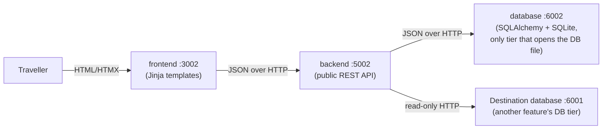
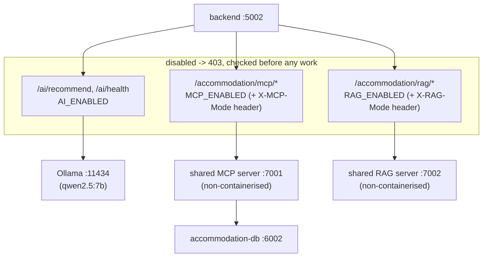
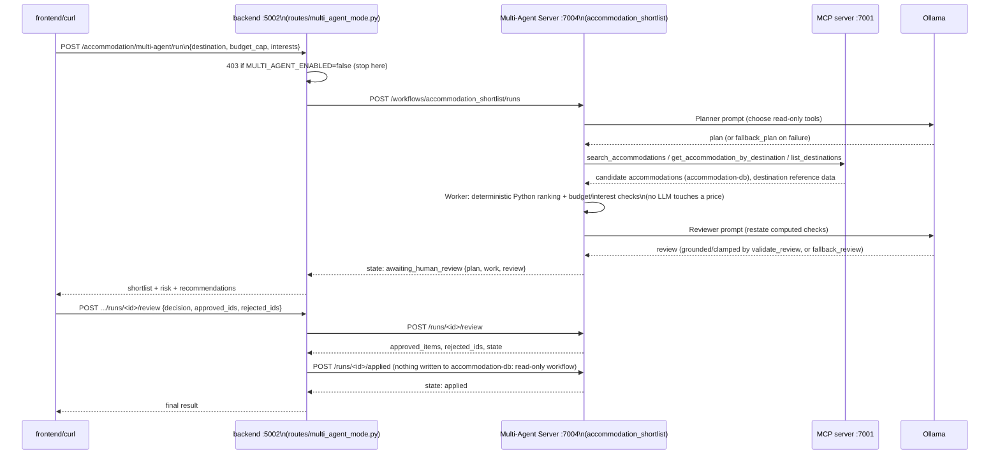
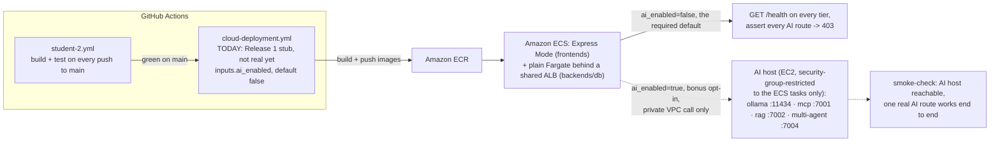

# Architecture: Accommodation (student-2) — Release 2

## 1. Frontend → Backend → Database

- Only `database/` touches `accommodation-db.sqlite`; `backend/` reaches it exclusively through
  `services/database_api.py` over HTTP, converting transport failures to 502 and 404s to 404.
- `backend/` also reads Destination's database tier directly (never its SQLite file) for
  cross-feature destination lookups.

## 2. AI-Mode, MCP and RAG flows (all disabled by default in the cloud)

- All three switches follow the same shape: read once at import time from an env var (default
  `true`), checked as the first line of the route body, 403 with a clear `error` message when
  off. `AI_ENABLED` is new in this change; `MCP_ENABLED`/`RAG_ENABLED` already existed.
- MCP and RAG additionally honour a per-request `X-MCP-Mode`/`X-RAG-Mode` header, matching the
  shared client shape documented in `ai-services/CLAUDE.md`.
- The shared MCP/RAG servers are deliberately **not containerised** — `backend` reaches them via
  `host.docker.internal` from inside Docker, the same pattern already used for Ollama.

## 3. Multi-Agent flow: Plan → Act → Observe → Human Review → Adapt

- `accommodation_shortlist`'s `allowed_tools` are all read-only (`search_accommodations`,
  `get_accommodation_by_destination`, `list_destinations`); it never calls `create_accommodation`
  and never writes to accommodation-db — human review decides what to keep, and
  `routes/multi_agent_mode.py` reports the run "applied" purely to close its lifecycle out.
- A tool failure becomes a `no_data` evidence entry, not a run failure; an LLM plan that names the
  write tool, or a review that recommends booking a specific place, is rejected by
  `validate_plan`/`validate_review` and replaced by the deterministic fallback.
- Live evidence of this exact flow (not simulated): [`multi-agent-workflow-evidence.md`](multi-agent-workflow-evidence.md).

## 4. Cloud deployment flow (proposed, not yet implemented — see `cloud-deployment-proposal.md`)

The group is going for the bonus marks (AI enabled in the cloud + cloud security controls), so
the diagram below shows both the required default (AI disabled) and the opt-in bonus path (AI
host reachable, security-group-restricted):

- The required baseline disables every AI-shaped surface by default, using the same env vars
  already proven by `docker-compose.ci.yml` and the `verify-ai-disabled` CI job — no new
  mechanism, just the same flags applied by the (not-yet-built) deployment pipeline instead of a
  compose override. `inputs.ai_enabled` defaults to `false` so this stays the default path.
- The bonus path points the same env vars at an EC2 host running the exact same
  `ollama`/`mcp_http_server.py`/`rag_http_server.py`/`multi-agent-server/server.py` processes
  already used locally, reachable only from the feature services' security group — see
  `cloud-deployment-proposal.md` sections 3-4 for the full design and the security controls around it.
- This diagram is illustrative: `cloud-deployment.yml` does not implement any of this today, and
  this change does not create it — see `cloud-deployment-proposal.md` for the full reasoning and
  what the team still needs to agree on.
