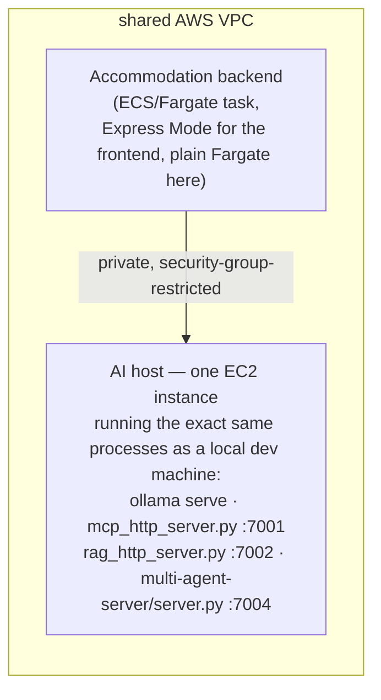

# Cloud deployment proposal — draft, for team review (Accommodation as pilot)

**Status: proposal only.** `.github/workflows/cloud-deployment.yml` is currently a Release 1 stub
(`# Only for RELEASE 01`) and no Release 2 cloud pipeline exists yet for any of the five feature
services. This document sketches what that pipeline could look like on **AWS** (the group's
chosen provider), using Accommodation as the worked example, so the team can agree on a shared
shape before anyone wires up real infrastructure or billing. Nothing here touches the real
`cloud-deployment.yml`, creates any cloud resources, or is wired into CI — it is a starting point
for a team decision.

**The group has decided to go for the bonus marks**: enabling AI services in the cloud, plus
cloud security controls (sections 3 and 4). The brief is explicit that the *required* baseline
must still default to AI disabled — the bonus is an additional, opt-in configuration layered on
top of that baseline, not a replacement for it. Everything here is written with that in mind:
sections 1-2 are the required baseline; sections 3-4 are the bonus path.

## 1. Target: Amazon ECS Express Mode (recommended) over plain ECS/Fargate or Kubernetes

**Correction (checked 2026-10-21): AWS App Runner stopped accepting new customers on
2026-04-30** — a fresh account cannot create a new App Runner service any more, only existing
customers can keep using what they already have. The original version of this proposal
recommended App Runner; that is no longer an option for us starting from scratch, so this
revision targets its AWS-recommended replacement instead. [[AWS App Runner availability
change]](https://docs.aws.amazon.com/apprunner/latest/dg/apprunner-availability-change.html)

| Option | Fit for this project |
|---|---|
| **Amazon ECS Express Mode** (recommended) | AWS's own migration path off App Runner: one API call per service (container image + two IAM roles) and ECS provisions the whole stack — a Fargate service, an Application Load Balancer, auto scaling, networking — for you. No extra charge for Express Mode itself; you pay standard Fargate + ALB rates underneath. Tasks run in our VPC natively, so inter-service calls (frontend → backend → database → AI host, section 3) stay on private networking with no extra connector step. **Caveat:** Express Mode gives each service its own ALB by default — see the cost note in section 2 for why we should NOT do that for all 18 tiers. |
| Plain ECS on Fargate (no Express Mode) | Same underlying compute and networking, but we set up the VPC/subnets/security groups/one shared ALB ourselves instead of letting Express Mode auto-provision one per service. More one-time setup, but the only way to get a single shared ALB across all five features instead of paying for 18. Recommended for the backend/database tiers, which don't need to be public at all. |
| Kubernetes (EKS) | Deliberately avoided: 18 tiny Flask/SQLite services (plus one AI host) do not need pod autoscaling, ingress controllers or Helm charts. |

This proposal recommends a **mix**: Express Mode for the five frontends (the only tiers that
need a public URL), plain Fargate services behind one shared, manually-created ALB for every
backend and database tier (which only need to be reached from inside the VPC), and the EC2 AI
host from section 3 reachable the same way. This keeps the "push an image, get a URL" simplicity
where it's actually needed and avoids paying for 13 ALBs nothing outside the VPC should be
calling anyway.

## 2. Cloud baseline (required): everything AI-shaped disabled by default

Every feature's `docker-compose.ci.yml` already proves the "disabled" shape works (CI runs today
with these flags off). The same env vars, set as service environment variables instead of a
compose override file, give the **default** cloud deployment the same baseline:

```yaml
# illustrative: per-service env vars on the default cloud deployment, not a real file in this repo
AI_ENABLED: "false"
MCP_ENABLED: "false"
RAG_ENABLED: "false"
MULTI_AGENT_ENABLED: "false"
```

A `docker-compose.cloud.yml` per feature (mirroring each service's existing `docker-compose.ci.yml`
pattern exactly — same keys, same `false` values) would let anyone `docker compose config` the
cloud shape locally before trusting it to actually deploy. Accommodation's would be:

```yaml
# accommodation-service/docker-compose.cloud.yml — DRAFT, not created by this change
services:
  backend:
    environment:
      - MCP_ENABLED=false
      - RAG_ENABLED=false
      - MULTI_AGENT_ENABLED=false
      - AI_ENABLED=false
```

Every route gated by these flags already returns 403 (`/ai/recommend`, `/accommodation/mcp/*`,
`/accommodation/rag/*`, `/accommodation/multi-agent/*` — see
[`post-commit-cicd-report.md`](post-commit-cicd-report.md) for the live 403 evidence from the
`verify-ai-disabled` CI job). This file (or env-var set) stays the default for every deployment;
section 3's overlay is what a marker/demo session opts into on top of it.

**Cost note (why not 18 Express Mode services):** each Express Mode service provisions its own
Application Load Balancer (~$0.0225/hr fixed, before any traffic) — fine for the 5 public
frontends, wasteful for the 13 backend/database tiers that only ever need to be reached from
inside the VPC. One shared ALB with path/host-based routing for the internal tiers, or none at
all if they're only ever called service-to-service, keeps the baseline cheap — see the worked
cost estimate below.

## 3. Bonus: enabling AI services in the cloud

Locally, `ai-services/CLAUDE.md` is explicit that MCP, RAG, the Multi-Agent Server and Ollama are
**one shared, non-containerised instance for the whole team** — every feature's client code
already reads its URL from `os.environ.get(NAME, <localhost default>)`, so nothing in
`accommodation-service` (or any other feature) needs to change to point at a different host; only
the deployed env vars need to change.

**Recommended shape: one AI host, same processes as today, in the same VPC as the feature
services.**



- **Why one EC2 instance, not containerising these three servers:** it is the smallest possible
  diff from what already works. `ollama serve`, `mcp_http_server.py`, `rag_http_server.py` and
  `multi-agent-server/server.py` already run as plain host processes locally with zero Docker
  involvement — the same processes under `systemd` (auto-restart on crash/reboot) on one EC2
  instance need no new Dockerfiles, no new CI jobs, and no code changes anywhere in this repo.
  Containerising them (ECS tasks instead of EC2) is a reasonable alternative if the team wants
  managed restarts/logging through ECS instead of systemd, at the cost of writing four new
  Dockerfiles and rewiring each `*_SERVICE_URL` — `ai-services/CLAUDE.md` permits this
  ("do not containerise ... without also rewiring every feature's `MCP_SERVICE_URL`/
  `RAG_SERVICE_URL`") but it is strictly more work than this proposal needs for a first bonus pass.
- **Sizing:** `qwen2.5:7b` needs CPU inference headroom — an instance in the `m5.xlarge`/`t3.xlarge`
  class (4 vCPU, 16 GB RAM) is a reasonable starting point; this is not a GPU workload, just a
  slower-than-local-dev-laptop one. Stop the instance outside of marking/demo windows to control
  cost — the same instance type and setup is reused for every feature's AI calls, so this is a
  one-off cost for the whole group, not per-feature.
- **Enabling it for a demo**: the same `docker-compose.cloud.yml` pattern, flipped on, pointing at
  the AI host's private DNS name instead of `host.docker.internal`:

  ```yaml
  # accommodation-service/docker-compose.cloud-ai-enabled.yml — DRAFT, bonus overlay, opt-in only
  services:
    backend:
      environment:
        - MCP_ENABLED=true
        - MCP_SERVICE_URL=http://ai-host.internal:7001
        - RAG_ENABLED=true
        - RAG_SERVICE_URL=http://ai-host.internal:7002
        - MULTI_AGENT_ENABLED=true
        - MULTI_AGENT_SERVICE_URL=http://ai-host.internal:7004
        - AI_ENABLED=true
        - OLLAMA_HOST=http://ai-host.internal:11434
  ```

  Deploying this overlay instead of (or layered on top of) section 2's baseline is a deliberate,
  separate action — e.g. a second `workflow_dispatch` input on `cloud-deployment.yml`
  (`ai_enabled: true/false`, default `false`) — never the default path.

## 4. Bonus: cloud security controls

- **Network isolation (the main control):** the AI host's security group allows inbound on
  `7001`/`7002`/`7004`/`11434` **only** from the feature services' security group — never
  `0.0.0.0/0`. None of MCP, RAG or the Multi-Agent Server have their own authentication today
  (confirmed in `ai-services/CLAUDE.md` — they are designed to be reached only by trusted
  containers on the same host); in the cloud, the security group is what stands in for "same
  host" and is load-bearing, not optional.
- **IAM least privilege:** the CI role used by the `build-and-push`/`deploy` jobs is scoped to
  only `ecr:PutImage` + ECS update actions on this project's specific resources (named by ARN,
  not `*`), not an admin role.
- **Secrets:** nothing in this design needs an API key today (Ollama is self-hosted, no key).
  If the team later swaps any component to a hosted LLM API, its key goes in AWS Secrets Manager
  or SSM Parameter Store, injected as a runtime env var — never committed to a compose file or
  this repo, mirroring how `.secrets.baseline`/detect-secrets already guard against that locally.
- **TLS boundary:** the shared ALB terminates HTTPS automatically for every public-facing
  service. Traffic from the backend to the AI host stays inside the VPC behind the security group above,
  so plain HTTP between them is a deliberate, documented choice (least exposure is the security
  group, not transport encryption for a link nothing outside the VPC can reach), not an oversight.
- **Blast radius:** keeping the AI-enabled overlay (section 3) as an explicit opt-in, separate
  from the baseline deploy, means a misconfigured or forgotten `workflow_dispatch` run can't
  silently leave AI-Mode on in the grading deployment — the default input value stays `false`.

## 5. Estimated cost for a 1-day demo (answering: is a $200 credit enough?)

**Short answer: yes, comfortably** — a full 24-hour continuous run of everything, AI-enabled
path included, comes to roughly **$20-25**, under 15% of a $200 credit. Prices below are
on-demand, `us-east-1`, checked 2026-10-21.

| Item | Rate | 24h cost | Notes |
|---|---|---|---|
| Fargate compute, 18 tasks × 0.25 vCPU / 0.5 GB (minimum size) | $0.04048/vCPU-hr + $0.004445/GB-hr | ≈ $5.33 | 18 × (0.25 × $0.04048 + 0.5 × $0.004445) × 24h |
| Shared ALB (backends/db, internal) | $0.0225/hr + LCUs | ≈ $0.54 + a few cents | LCU usage is negligible for a classroom demo audience |
| Express Mode ALBs × 5 (public frontends) | $0.0225/hr each | ≈ $2.70 | 5 × $0.0225 × 24h |
| EC2 AI host, `m5.xlarge` (4 vCPU/16GB, CPU inference for qwen2.5:7b) | $0.192/hr | ≈ $4.61 | confirmed on-demand rate |
| EBS for the AI host (model + OS, ~30GB gp3) | prorated monthly | ≈ $0.08 | negligible for one day |
| NAT gateway (if private subnets need outbound internet) | $0.045/hr + $0.045/GB processed | ≈ $1.08 + a few cents | avoidable with a VPC endpoint for ECR instead, if we want to shave this |
| ECR image storage, ~9GB across 18 images | ~$0.10/GB-month | < $0.10/day | |
| **Total, 24h continuous, both baseline and bonus running** | | **≈ $14.50-16** | |

A more realistic demo (spin everything up a couple of hours before, run the session itself,
tear down after — call it 6-8 hours total) comes to roughly **$4-5**.

**The real risk to the $200 credit isn't the demo — it's forgetting to tear things down
afterwards.** At the 24h-continuous rate above, even a full week of accidentally-left-running
resources is ≈ $100-115, still under budget, but there's no reason to test that: stop the EC2
host and scale the ECS services to 0 desired count (or delete them) as the very last step after
the demo, not "at some point."

Sources: [AWS App Runner availability change](https://docs.aws.amazon.com/apprunner/latest/dg/apprunner-availability-change.html),
[Amazon ECS Express Mode overview](https://docs.aws.amazon.com/AmazonECS/latest/developerguide/express-service-overview.html),
[AWS Fargate pricing (CloudZero)](https://www.cloudzero.com/blog/fargate-cost/),
[m5.xlarge pricing (devzero)](https://www.devzero.io/instances/aws/m5.xlarge).

## 6. Draft pipeline shape

```yaml
# .github/workflows/cloud-deployment.yml — illustrative shape, NOT applied by this change
name: cloud-deployment
on:
  workflow_dispatch:
    inputs:
      ai_enabled:
        description: "Deploy with AI-Mode/MCP/RAG/Multi-Agent enabled (bonus path)"
        type: boolean
        default: false        # required baseline: disabled unless explicitly opted into
jobs:
  gate:
    # Require every feature's own CI (student-1..5) to be green on main before deploying anything.
    ...
  build-and-push:
    # docker build + push each tier's image to Amazon ECR, per feature.
    ...
  deploy:
    # aws ecs create-express-service (frontends) / aws ecs update-service (backends+db),
    # or Terraform apply, per tier. env vars come from docker-compose.cloud.yml, or
    # docker-compose.cloud-ai-enabled.yml only when inputs.ai_enabled is true.
    ...
  smoke-check:
    # curl /health on every deployed tier; if ai_enabled=false, assert every AI route -> 403;
    # if ai_enabled=true, assert the AI host is reachable and one real AI route works end to end.
    ...
```

The `gate` job matters most: today, `student-2`'s own CI (`.github/workflows/student-2.yml`) runs
on every push to `main`, unfiltered, specifically so a cloud-deployment gate can always find a
fresh green run for the commit it is about to deploy. The other four students' workflows should
adopt the same unfiltered-push pattern if they haven't already.

## 7. What this proposal does not decide

- Which AWS account to deploy into, and who owns the credentials/billing.
- Whether to deploy all five features into one shared VPC (cheaper, simpler to manage) or five
  separately — recommend one shared setup given the project's size.
- Exactly who stands up and pays for the AI host EC2 instance, and the schedule for
  starting/stopping it around marking/demo sessions — a team logistics decision.
- Whether the backend/database tiers go behind one shared manually-created ALB (cheaper) or each
  gets its own Express Mode service (simpler to set up, 13 extra ALBs) — section 1 recommends the
  shared-ALB split, but it needs the team's buy-in since it's more setup work.

## 8. Next step

Bring this to the team as a starting point: agree on the Express-Mode-for-frontends /
shared-ALB-for-backends split, agree on who stands up the AI host EC2 instance and its start/stop
schedule, agree on the unfiltered-push-on-main CI pattern for every student workflow, then one
person opens the PR that actually creates `.github/workflows/cloud-deployment.yml` and the
per-feature `docker-compose.cloud.yml` / `docker-compose.cloud-ai-enabled.yml` files together, so
the gate job has something real to check against from day one.
