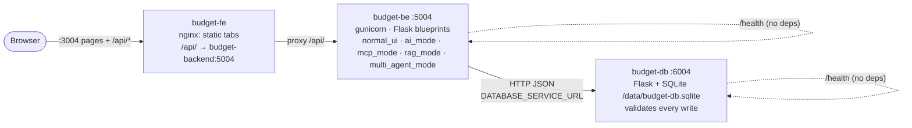
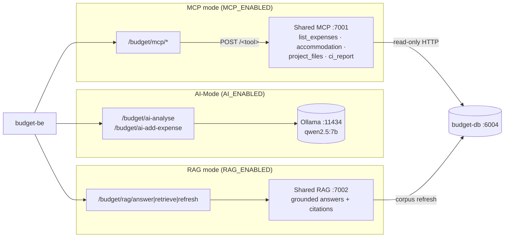
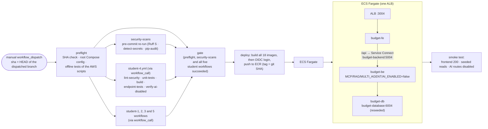

# Budget (Student 4) architecture, Release 2

Budget is three containers: **budget-fe** (nginx, :3004), **budget-be** (Flask on gunicorn, :5004) and
**budget-db** (Flask + SQLite, :6004). The shared AI services (MCP :7001, RAG :7002, Multi-Agent :7004, Ollama
:11434) run on the host, are reached through `host.docker.internal`, and each has its own on/off switch.

## 1. Frontend → Backend → Database



- The browser only talks to `:3004`. The tabs call `API_BASE = "/api"`, and nginx forwards to `budget-backend:5004`.
  The same name works in the root compose file, in `budget-service/docker-compose.yml` (network alias) and on
  AWS (Service Connect).
- budget-db is the only component that opens the SQLite file. It seeds 12 rows **only when the table is empty**
  (`BUDGET_DB_RESEED=1` to reset).

## 2. AI-Mode, MCP and RAG flows (Release 0/1, unchanged except the AI-Mode switch)



Each mode returns **403 "… disabled"** when its flag is `false`, as in CI and the cloud. AI-Mode got this
switch in Release 2 (`AI_ENABLED`); MCP and RAG had theirs since Release 1.

## 3. Multi-Agent flow: Plan → Act → Observe → Human Review → Adapt

```mermaid
sequenceDiagram
    autonumber
    actor U as Traveller (UI or curl)
    participant FE as budget-fe :3004
    participant BE as budget-be :5004
    participant MAS as Multi-Agent Server :7004
    participant P as Planner (qwen2.5:7b)
    participant W as Worker (Python)
    participant T as MCP :7001 / RAG :7002
    participant R as Reviewer (qwen2.5:7b + rules)
    participant DB as budget-db :6004

    U->>FE: trip_reference + budget_cap
    FE->>BE: POST /api/budget/multi-agent/run
    BE->>MAS: POST /workflows/budget_reconcile/runs
    MAS->>P: Plan: choose read-only sources (+ reason each)
    P-->>MAS: JSON plan (validated; fallback = all sources)
    MAS->>W: Act
    W->>T: list_expenses, get_itinerary, list_activities, ... (allowlist, read-only)
    T-->>W: evidence ("no data from X" if a feature is down)
    W-->>MAS: draft lines + totals (Python arithmetic)
    MAS->>R: Observe: overspend, actual > estimate, duplicates, missing categories
    R-->>MAS: review grounded in computed checks
    MAS-->>BE: 201 run (awaiting_human_review)
    BE-->>FE: plan · work · review
    U->>FE: approve / untick / edit lines + note
    FE->>BE: POST /api/budget/multi-agent/runs/<id>/review
    BE->>MAS: POST /runs/<id>/review (one decision only; 2nd = 409)
    MAS-->>BE: approved_items
    loop each approved/edited line (Adapt)
        BE->>DB: POST /expenses (status Planned)
    end
    BE->>MAS: POST /runs/<id>/applied {created_ids}
    BE-->>FE: created expense ids
```

- The server never writes Budget data. Only budget-be writes, and only the approved lines. A failed write
  rolls back the lines already written.
- **Reject** writes nothing. A **second decision** gets 409 before anything is written.
- **Boundaries:** read-only tools only, amounts and categories only, and out-of-scope requests (e.g. "book a
  cheaper hotel") are declined.

## 4. AWS deployment flow (shared PR #20)



In the cloud every AI path is off, and Budget's `verify-ai-disabled` CI job already proves that all six AI
routes return 403 under `docker-compose.ci.yml`.
