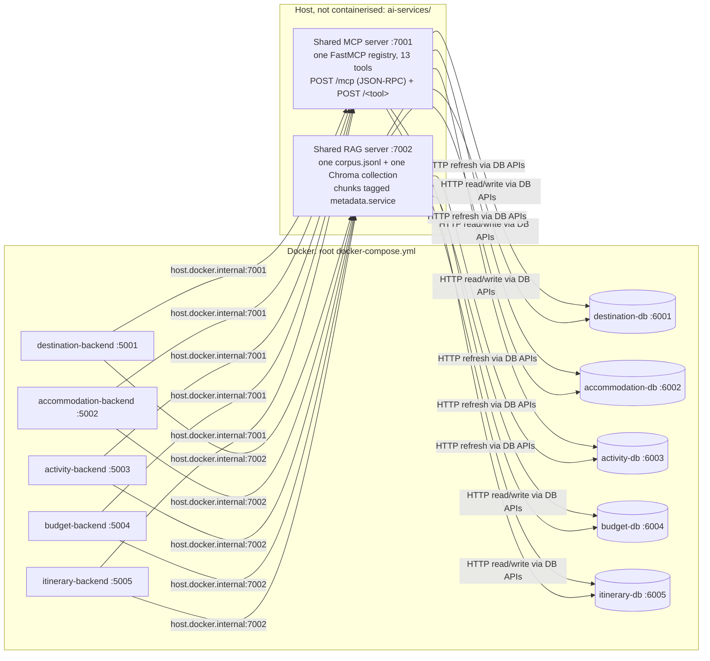

# Shared MCP / RAG integration — Release 1

**Claim:** all five feature backends call **one** shared MCP server
(`ai-services/mcp-server`, port **7001**) and **one** shared RAG server
(`ai-services/rag-server`, port **7002**). No feature runs its own MCP or RAG
server. Activity's former dedicated servers have been retired: their tools
and corpus now live in the shared servers. This addresses review feedback
C1, C3, C4 and C8. Release 0 CRUD and AI Mode were re-validated alongside
Release 1 MCP and RAG Mode for every feature (C2).

Evidence is in [`docs/evidence/shared-integration/`](evidence/shared-integration/).
It was produced on 2026-10-18 by `scripts/smoke_shared_integration.py` (smoke run `6652f0`)
plus the test suites listed below.

## Architecture



Every hop from the shared servers to feature data goes through that feature's database HTTP API.
Neither server opens another service's SQLite file.

## Per-feature evidence

The "URL called" column was read from inside each running container (`printenv`), not from config files.
"Corpus tag" is the `metadata.service` value the feature's chunks carry in the shared corpus. Chunk
counts come from the live refresh in the smoke run: 149 chunks in total, every source `ok`, vector store `ready`.

| Feature | MCP tools used (shared :7001) | RAG corpus tag / scope (shared :7002) | URL called | Proving tests | Result |
| --- | --- | --- | --- | --- | --- |
| Destination (S1) | `list_destinations` via `POST /mcp` (JSON-RPC) | `destination` (10 chunks), unscoped | `http://host.docker.internal:7001` / `:7002` | `student-1/tests` (209); `ai-services/mcp-server/tests/test_activity_tools.py::test_destination_style_jsonrpc_and_activity_style_shim_on_same_server`; smoke CRUD 5/5, AI 1/1, MCP 1/1, RAG 1/1 | PASS |
| Accommodation (S2) | `get_accommodation_by_destination`, `search_accommodations`, `create_accommodation` (+ `list_expenses`, `ci_report`) via `POST /<tool>` | `accommodation` (35), unscoped | `http://host.docker.internal:7001` / `:7002` | `accommodation-service/backend/tests` (47), `frontend/tests` (2); `ai-services/mcp-server/tests` (71); smoke CRUD 5/5, AI 1/1, MCP 1/1, RAG 1/1 | PASS |
| Activity (S3) | `list_activities`, `get_activity`, `get_activity_assignments`, `list_assignments`, `get_assignment` via `POST /<tool>`; **moved into the shared server** | `activity` (78), `scope="activity"` | `http://host.docker.internal:7001` / `:7002` | `activity-service/tests/test_shared_mcp_bridge.py` + `test_shared_rag_bridge.py` (54, both drive the real shared servers); `ai-services/mcp-server/tests/test_activity_tools.py`; `ai-services/rag-server/tests/test_activity_scope.py`; `activity-service/{backend,database-service,frontend}/tests` (30/12/34); agentic loop `--mode activity_rag` PASS; smoke CRUD 6/6, AI 1/1, MCP 2/2, RAG 2/2 | PASS |
| Budget (S4) | `list_expenses`, `get_accommodation_by_destination`, `project_files`, `ci_report` via `POST /<tool>` | `budget` (13), unscoped | `http://host.docker.internal:7001` / `:7002` | No pytest suite exists for budget-service; `ai-services/mcp-server/tests/test_mcp_server.py::test_shim_list_expenses_accepts_null_trip_reference`; smoke CRUD 5/5, AI 1/1, MCP 1/1, RAG 1/1 | PASS |
| Itinerary (S5) | `get_itinerary` via `POST /<tool>` | `itinerary` (12), `scope="itinerary"` | `http://host.docker.internal:7001` / `:7002` | `itinerary-service/itinerary-be/tests` (105), `itinerary-db/tests` (16), `itinerary-service/tests` (49); smoke CRUD 5/5, AI 1/1, MCP 1/1, RAG 2/2 | PASS |

Shared-server suites: `ai-services/mcp-server/tests` 71, `ai-services/rag-server/tests` 75, `ai-services/agentic_loop/tests` 71.
**All 13 suites: 775 passed, 0 failed** ([test-suites.txt](evidence/shared-integration/test-suites.txt)), against a baseline of 765 before these changes.
Smoke: **44/44 checks** ([smoke-results.md](evidence/shared-integration/smoke-results.md)).

### Retrieval quality per feature (`rag_eval.py`, live corpus)

| Feature | Scope | Queries | Mean P@5 | Mean R@5 |
| --- | --- | --- | --- | --- |
| destination | unscoped | 2 | 0.40 | 1.00 |
| accommodation | unscoped | 2 | 0.40 | 0.50 |
| activity | activity | 3 | 0.67 | 1.00 |
| itinerary | itinerary | 1 | 1.00 | 1.00 |
| budget | unscoped | 2 | 0.60 | 0.60 |
| shared docs | unscoped | 1 | 0.00 | 0.00 |

A chunk counts as relevant when it belongs to the benchmark's feature and contains one of the benchmark's
keywords. R@5 = relevant chunks retrieved / min(5, relevant chunks in the corpus). Destination's P@5 can be
at most 0.4 here, because the live corpus has only two matching destinations.
Full per-query detail: [retrieval-metrics.md](evidence/shared-integration/retrieval-metrics.md).

## What changed

- **MCP.** Activity's five read-only tools moved into `ai-services/mcp-server/tools.py`. They read the
  activity DB over HTTP via `ACTIVITY_DB_URL` (default `http://localhost:6003`). They are registered
  once, in the shared FastMCP registry (`server.py`), and the registry serves **both** request formats
  at the same time:
  - JSON-RPC on `POST /mcp` with `Accept: application/json, text/event-stream` (Destination's `mcp_client.py`).
  - The `POST /<tool>` shim (Activity, Accommodation, Budget, Itinerary).

  `mcp-config.json` and `tool-contracts.md` were updated to match.
- **RAG.** Activity's corpus is built inside the shared pipeline, in the Activity section of `ai-services/rag-server/rag_pipeline.py`.
  It produces records, assignments, per-category summaries, Activity docs and an Activity file index.
  - **Service tags.** Every chunk from every feature carries `metadata.service`, both in `corpus.jsonl`
    and in Chroma.
  - **Activity scope.** Activity's backend sends `scope="activity"`. Two Activity-specific behaviours were
    ported because its backend and UI rely on them: deterministic answers for count and per-category
    questions, and a numeric `distance` on every retrieved row.
  - **Unscoped queries unchanged.** Activity's slice is scoped-only, so unscoped queries from Destination,
    Accommodation and Budget get exactly the results they got before. A test asserts this.
- **Activity backend.** It now points at `:7001` and `:7002`: compose files, `services/rag_api.py`
  and `routes/mcp_mode.py`. `services/ai_client.py` only talks to Ollama, so it needed no change.
  The overrides are now `ACTIVITY_MCP_*` and `ACTIVITY_RAG_*`, matching the `DESTINATION_` and
  `ITINERARY_` convention.
  - `activity-service/mcp-server/` and `activity-service/rag-server/` were deleted, and their tests
    were ported to run against the shared servers.
  - The agentic loop's `activity_rag` mode now drives the shared server.
  - No script, compose file or current doc references ports 7003 or 6013 any more. Activity's dated
    reports carry a "superseded" banner. Two assertions in `student-1/tests` still mention 7003/6013
    on purpose: they guard against those ports coming back.

## Defects found and fixed during regression

1. **Budget MCP returned 502 on the merged branch.** FastMCP rejected the `{"trip_reference": null}`
   that Budget sends when no trip is selected. `main` accepted it. The parameter is now nullable,
   with a regression test.
2. **Answers grounded in stale fixture data.** Activity's dated run logs quoted test-fixture records:
   asking about "Harbour Kayaking Tour", which does not exist in the live database, returned
   "$45.00, High". `run-report.md` and `test-results.md` are now excluded from the corpus, so record
   facts come from the live DB only.
3. **An abstention could look like a cited answer.** A model reply of `Answer:\nInsufficient evidence.`
   came back as `status: success` with citations. This affected the unscoped path too, so all features.
   The `Answer:` prefix is now stripped before the abstention check. Proof:
   [stale-record-refusal.json](evidence/shared-integration/stale-record-refusal.json) is now
   `insufficient_context`, with no citations.

## Known gaps (not fixed here)

- **Generic queries retrieve nothing.** Unscoped acceptance requires two matched terms, or a destination
  city or country. A one-term query such as "accommodation options" therefore retrieves nothing
  (accommodation R@5 0.5). "budget expenses over estimate" only matches the expense-count chunk, because
  "estimate" is not "estimated_cost". As a result Budget's RAG answer to it is Insufficient. Both come
  from the shared acceptance rule in the merged branch, which this change deliberately leaves alone.
- **Missing shared docs.** `docs/ARCHITECTURE.md` and `budget-service/SUMMARY.md` are listed as
  corpus sources but do not exist, so the shared-docs benchmark scores 0.
- **Activity's database starts empty.** A fresh volume has no activities by design. The smoke script runs
  Activity's documented, idempotent seed (`seed_mock_data.py`) before its checks.
- **Generated files are gitignored.** `ai-services/rag-server/retrieval-metrics.md` and the corpus/Chroma
  files are gitignored, which is why a copy of the metrics is kept under `docs/evidence/`.

## Reproduce

```bash
# repo root; interpreter needs mcp, chromadb, requests (ai-services requirements)
python scripts/smoke_shared_integration.py --build     # compose up + shared servers + 44 checks
cd ai-services/rag-server && python rag_eval.py --refresh
python ai-services/agentic_loop/app_main.py --mode activity_rag --no-llm   # needs :7002 running
```
